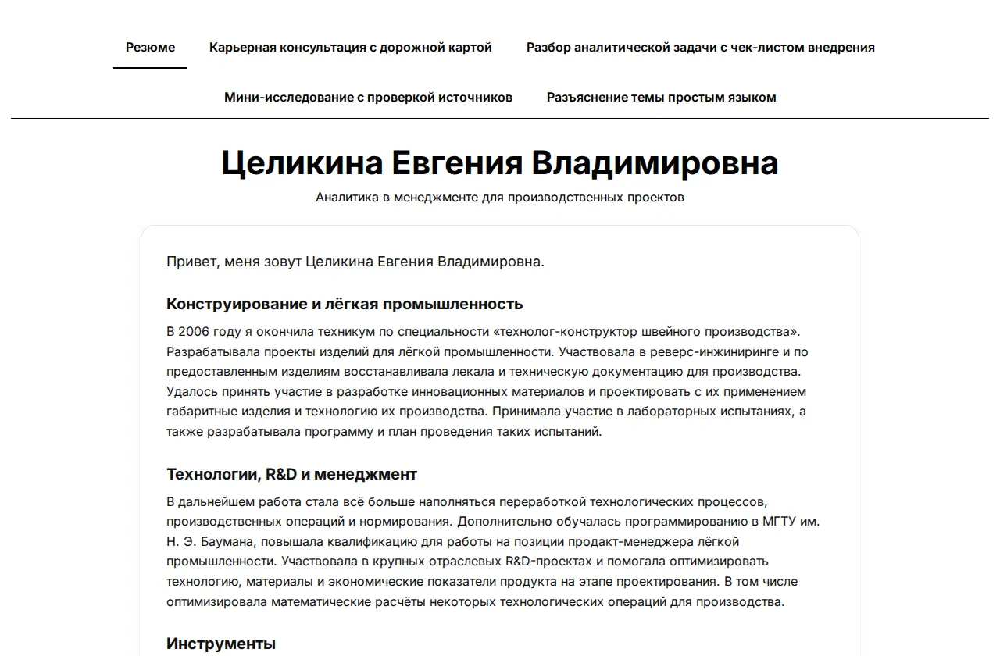

# Витрина услуг

Адаптивный сайт услуг на HTML / CSS / JavaScript: отдельные страницы, светлая и тёмная темы, подтверждение согласия с условиями перед переходом к оплате.

[**Открыть сайт**](https://vremennobeznika.github.io/evosif/)

**Что посмотреть:** откройте услугу, раскройте полный текст оферты, проверьте состояние кнопки до и после двух отметок согласия. Переключите тему и размер экрана. Для знакомства с интерфейсом проводить оплату не требуется.

**Локальный запуск:** `python3 -m http.server 8000` → http://localhost:8000/; сборка не требуется.

## Скриншоты

Статический сайт-витрина: профессиональные услуги по карьере, аналитике, исследованиям и объяснению сложных тем. У каждой услуги своя страница с публичной офертой: короткая версия, полный текст по кнопке и оплата после согласия с условиями.

## Файлы

- `index.html` — главная: о специалисте, контакты и карточки услуг
- `career.html` — карьерная консультация с дорожной картой
- `analytics.html` — разбор аналитической задачи с чек-листом внедрения
- `research.html` — мини-исследование с проверкой источников
- `explain.html` — разъяснение темы простым языком
- `style.css`, `theme.js` — оформление и переключатель темы
- `offer.js` — включает кнопку оплаты после двух отметок согласия

## Публикация на GitHub Pages

1. Создайте репозиторий и загрузите все файлы в корень (не в подпапку).
2. Settings → Pages → Source: «Deploy from a branch», ветка `main`, папка `/ (root)`.
3. Через минуту-две сайт откроется по адресу `https://<логин>.github.io/<репозиторий>/`.

Тексты оферт, суммы и дата публикации вписаны прямо в файлы страниц услуг: при изменении условий правьте их.
